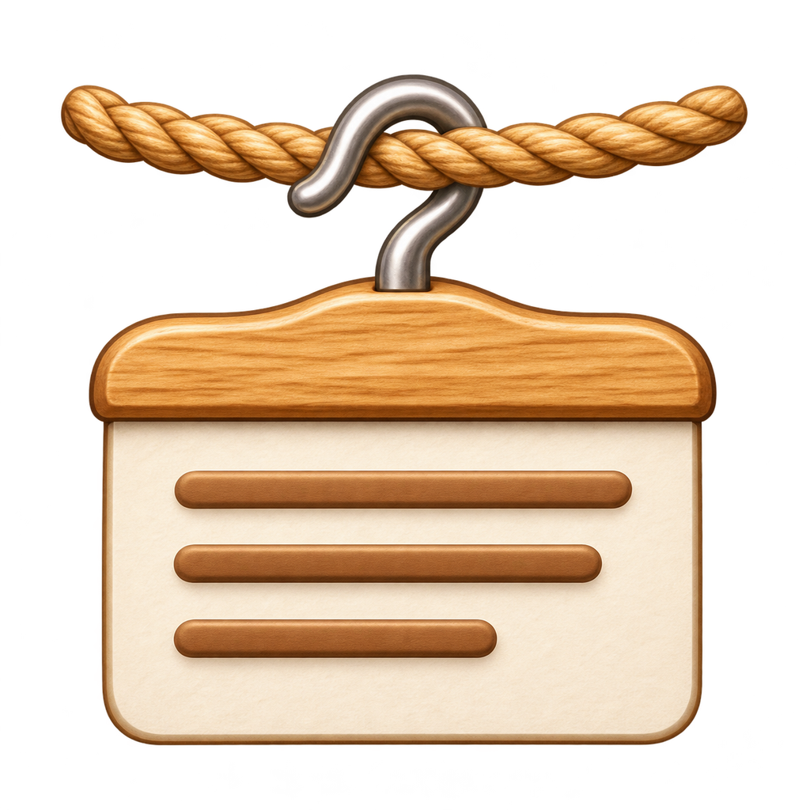
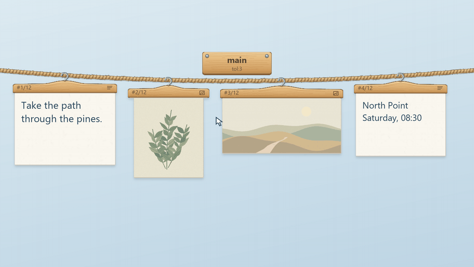

<p align="center">
  
</p>
<h1 align="center">ClipRope</h1>
<p align="center">A clipboard history manager for Windows. Hang clips on ropes or pull them onto your desktop.</p>
<p align="center"><strong>English</strong> · <a href="README.zh-CN.md">简体中文</a></p>
<p align="center"><a href="#quick-start">Quick start</a> · <a href="#mouse-gestures">Mouse gestures</a> · <a href="#shortcuts">Shortcuts</a> · <a href="#build-from-source">Build from source</a></p>

<p align="center">
  
</p>

Copy a paragraph, a screenshot, or a group of files. Each copy becomes a **Hanging card** on the active rope. Keep one rope for research and another for writing, or pull a card off the rope to keep it beside the document you’re working on. Your ropes and **Floating cards** are saved locally and return when you restart ClipRope.

## Quick start

Under **Releases → v0.1.0 → Assets**, download and run `ClipRope-0.1.0-windows-x64.exe`. Open **ClipRope** from the Start menu. To build your own copy, follow the [source instructions](#build-from-source).

1. In a text editor, copy two different lines, one at a time. Leave the caret where you want to paste.
2. Press **Ctrl+Shift+V** or left-click the tray icon. Find the card showing the first line you copied and double-click its paper with the left button. The card moves to the front of its rope, the workspace hides, and ClipRope sends **Ctrl+V** if the original editor is still a valid destination. You can also paste the restored text manually.
3. Open the rope again. Hold the left button on the center of a card, drag down past the row of cards, and release on the desktop. The card now floats beside your editor. Click **Return** at its upper left to hang it at the front of the currently active rope.

Prefer to paste by hand? In **Global settings → Cards**, set **Hanging double-click** to **Copy only**.

## Mouse gestures

**Drag** means hold the left mouse button, move the pointer, and release at the destination. You can start moving immediately. For a copy, hold **Ctrl before you start dragging**. Press **Esc** before dropping to cancel.

### Cards

| Gesture | Result |
| --- | --- |
| Double-click the center of a Hanging card | Restores the saved content, moves the card to the front of its own rope, and hides the workspace. By default, ClipRope sends **Ctrl+V** to the original editor if it is still eligible. If an Explorer folder had focus, it can receive files, folders, or a screenshot PNG. |
| Double-click the center of a Floating card | Text opens for editing (**Ctrl+S** saves, **Esc** cancels). A file or screenshot opens in its default app. A folder or file group is revealed in Explorer. Other content opens Card information. |
| Drag a card by its center and release in a visible rope row | Drop into the gap that opens between neighboring cards. On the same rope this reorders the card. In overview, drop on another rope to move it there. A Floating card hangs at the indicated position. |
| Drag a card by its center and release outside all rope rows | A Hanging card becomes a Floating card. A Floating card moves to the new desktop position. |
| Click **Return** at the upper left of a Floating card | Hangs the card at the front of the rope that is collecting **when you click**, even if the workspace is hidden. |
| **Ctrl** + drag a card by its center in **single-rope view** | Drop into an editor or Explorer folder that accepts the content. A file card copies the original files, and a screenshot drops into a folder as a PNG. This also works from a Floating card while the workspace is hidden. |
| **Ctrl** + drag a card by its center in **overview** | Drop in a slot on any visible rope to create a copy there. Dropping outside the rows cancels the copy. |
| Drag a card edge | On Hanging paper, grab a side, the bottom, or a bottom corner. On a Floating text card, grab any edge or corner. Release at the desired size. |
| Right-click a card | Opens its content menu. To edit Hanging text in place, choose **Edit text…**. |
| Click **×** on a card | Hover a Hanging card to reveal **×**. By default it deletes that card directly. On a Floating card, **×** moves the card to **ReBin**. On ReBin itself, **×** permanently deletes the card. |
| Hover over a screenshot | Keep the pointer still on the image for half a second to see the full preview. Move away to dismiss it. |

To reach a slot offscreen, keep holding the card near the left or right end of the target row. The row scrolls under the pointer. Move inward, then release when you see the slot you want. On a full rope, inserting a card can evict the last one.

### Ropes and scrolling

Point at the rope line or its central wooden name plaque to act on the rope itself. For wheel gestures, the pointer can be anywhere in the row, including the gaps between cards.

| Gesture | Single-rope view | Overview |
| --- | --- | --- |
| Roll the wheel over a row | Browse cards along the rope. | Browse cards along the row under the pointer. |
| Hold **Ctrl** and roll the wheel | Up selects the previous collecting rope. Down selects the next. | Scroll the list of ropes vertically. The same rope keeps collecting. |
| Drag the rope line or plaque up or down | Release to save the rope’s height on the desktop. | Release between rows to reorder the ropes. The first rope in the new order collects future copies. |

Double-click a rope line or plaque in overview to select that rope and open it in single-rope view. Right-click either one to open its menu. Choose **Add new rope** to create a rope, then **Yes** to start collecting on it.

## Shortcuts

| Default shortcut | Action | Where it works |
| --- | --- | --- |
| **Ctrl+Shift+V** | Show or hide the workspace | System-wide |
| **Ctrl+Shift+Space** | Start a Floating quick note | System-wide |
| **Tab** | Switch to the next collecting rope | Over a rope or with the workspace focused |
| **Ctrl+Tab** | Toggle the rope overview | Over a rope or with the workspace focused |
| **Ctrl+F** | Find in Cards | Over a rope or with the workspace focused |

By default, switching to a nonempty rope also puts its first card on the clipboard. You can change this in **Global settings → Ropes**.

With **Find in Cards** open, type text, a link, or part of a file path. **Enter** selects the next match and **Shift+Enter** the previous one. Single-rope view searches the current rope. Overview searches across ropes.

## History and privacy

The active rope collects copies even while hidden. History lives in `%LOCALAPPDATA%\ClipRope` by default. Open **Global settings → Storage & Privacy** to exclude an application from capture, check disk usage, or move the history folder.

ClipRope keeps the clipboard formats it can restore. The receiving app chooses what to paste. For example, an Excel range can retain its values and formatting, while a chart may paste as a picture.

## Build from source

On Windows x64, install Git, PowerShell 7, Python 3.11 or newer, and Visual Studio 2022 with **Desktop development with C++**. The Release build requires MSVC 19.40.33811 (v143), CMake 3.28.3-msvc11, and Windows SDK 10.0.22621.0. In a Git clone of the repository, run `git switch --detach v0.1.0` to build this release.

From the repository root, build and run a development copy with its own history. If the installed copy is running, choose **Exit** from its tray menu first.

```powershell
pwsh -File tools/build.ps1
pwsh -File tools/build.ps1 -Action RunDev
```

The build writes `build/app/ClipRope.exe`. `RunDev` opens it with a separate history in `build/test-data/manual`. To make an installer, exit the development copy, run the core regression suite, and package the verified Release build.

```powershell
pwsh -File tools/build.ps1 -Action Test
pwsh -File tools/build.ps1 -Action Package
```

The test and packaging steps use NSIS 3.13. The build verifies its archive before use. For offline builds, place `nsis-3.13.zip` in `.local-artifacts/` first. The installer is written to `build/packages/ClipRope-0.1.0-windows-x64.exe`. See the [third-party notices](packaging/windows/ThirdPartyNotices.txt) for the components used in the release.
