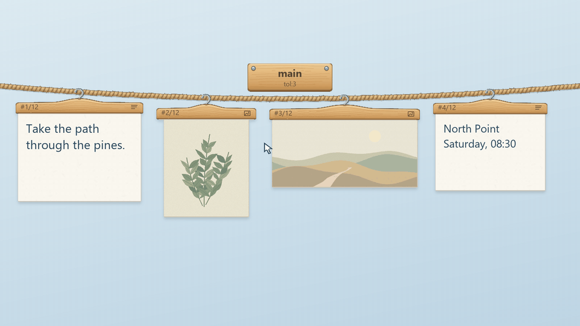

<p align="center">
  
</p>
<h1 align="center">ClipRope</h1>
<p align="center">把 Windows 剪贴板历史挂在绳上，需要时，摘一张放在桌面。</p>
<p align="center"><a href="README.md">English</a> · <strong>简体中文</strong></p>
<p align="center"><a href="#快速上手">快速上手</a> · <a href="#鼠标手势">鼠标手势</a> · <a href="#快捷键">快捷键</a> · <a href="#从源码构建">从源码构建</a></p>

<p align="center">
  
</p>

复制一段文字、一张截图或一组文件，当前绳子上就会多一张**绳上卡片**。你可以用一根绳子收集参考资料，用另一根整理写作素材，也可以把卡片拖到正在编辑的文档旁，作为**悬浮卡片**随时查看。绳子和卡片都保存在本机，重启 ClipRope 后，悬浮卡片也会回到原来的位置。

## 快速上手

在 **Releases → v0.1.0 → Assets** 中下载并运行 `ClipRope-0.1.0-windows-x64.exe`，然后从开始菜单打开 **ClipRope**。要自行编译，请参阅[从源码构建](#从源码构建)。

1. 在文本编辑器里先后复制两行不同的文字，然后把光标放到想粘贴的位置。
2. 按 **Ctrl+Shift+V** 或左键单击托盘图标。找到显示第一行文字的卡片，用左键双击卡片的纸面。它会回到绳首，工作区随即收起。如果原来的编辑器仍可接收粘贴，ClipRope 会向它发送 **Ctrl+V**。你也可以在目标位置手动粘贴刚恢复的文字。
3. 再次打开工作区。在卡片中央按住鼠标左键，向下拖出整行卡片的范围，在桌面上松开。卡片就会悬浮在编辑器旁。单击左上角的**回绳**，它就会挂到**当前绳子**的首位。

如果习惯手动粘贴，在**全局设置 → 卡片**中将**绳上卡片双击操作**设为**仅复制**即可。

## 鼠标手势

下文的**拖动**都是在起点按住鼠标左键，移动到目标再松开。按下即可开始移动。要复制卡片，**先按住 Ctrl，再开始拖动**。松开鼠标前按 **Esc** 可取消。

### 操作卡片

| 手势 | 操作结果 |
| --- | --- |
| 左键双击绳上卡片中央 | 内容恢复到剪贴板，卡片移到所属绳子的首位，工作区收起。默认情况下，如果原编辑器仍可接收粘贴，ClipRope 会向它发送 **Ctrl+V**。如果先前选中的是资源管理器的文件夹视图，该文件夹可接收文件、文件夹或截图 PNG。 |
| 左键双击悬浮卡片中央 | 文字可就地编辑，按 **Ctrl+S** 保存，按 **Esc** 取消。文件或截图用默认应用打开。文件夹或文件组会在资源管理器中定位，其他内容则显示卡片信息。 |
| 拖住卡片中央，在某一行绳子内松开 | 当相邻卡片让出空位时松手，卡片就挂到该位置。在同一根绳上是调整顺序，在总览中拖到另一根绳上是移动卡片。悬浮卡片也可以这样挂回指定位置。 |
| 拖住卡片中央，在所有绳子行以外松开 | 绳上卡片会成为独立的悬浮卡片。已经悬浮的卡片会移动到新的桌面位置。 |
| 单击悬浮卡片左上角的**回绳** | 卡片挂到**点击时正在收集内容的绳子**的首位。工作区收起时也能使用。 |
| **单绳视图**中，按住 **Ctrl** 拖动卡片中央 | 在支持该内容的编辑器或资源管理器文件夹内松开，即可复制内容。文件卡片复制原文件，截图拖入文件夹会生成 PNG。工作区收起时，也能从悬浮卡片这样拖出。 |
| **多绳总览**中，按住 **Ctrl** 拖动卡片中央 | 在任一可见绳子的空位松开，即可在该位置创建副本。在所有绳子行以外松开会取消复制。 |
| 拖动卡片边缘 | 绳上卡片可拖纸面的左右边、底边或底部两角。悬浮文字卡片可拖任一边或角。达到所需大小后松开。 |
| 右键单击卡片 | 打开该卡片的菜单。要直接编辑绳上文字，选择**编辑文字…**。 |
| 单击卡片上的 **×** | 鼠标移到绳上卡片时会显示 **×**，默认单击即直接删除。悬浮卡片的 **×** 默认将它移入**回收绳（ReBin）**。回收绳上的 **×** 会永久删除该卡片。 |
| 鼠标悬停在截图上 | 将指针停在截图中央约半秒即可预览全图，移开指针即可收起。 |

要把卡片放到屏幕外的位置，拖动时保持左键按下，把指针停在目标行的左端或右端。卡片会自动滚动。看到想要的位置后，把指针移回行内，在空位松开。绳子已满时，插入卡片可能挤掉绳尾的卡片。

### 操作绳子与滚轮

要移动整根绳子，把指针放在绳线或中央的木质名牌上。使用滚轮时，指针放在该行任意位置都可以，包括两张卡片之间的空隙。

| 手势 | 单绳视图 | 多绳总览 |
| --- | --- | --- |
| 指向一行，滚动滚轮 | 沿当前绳子左右浏览卡片。 | 只浏览指针所在行的卡片。 |
| 按住 **Ctrl** 滚动滚轮 | 向上滚切到上一根收集绳，向下滚切到下一根。 | 上下浏览绳子列表，接收新复制内容的绳子保持不变。 |
| 按住绳线或名牌，上下拖动 | 松开后保存这根绳子在桌面上的高度。 | 拖到目标行间松开以调整绳子顺序。排在首位的绳子负责收集之后复制的内容。 |

在总览中，左键双击某根绳子的绳线或名牌，即可选中它并进入单绳视图。右键单击绳线或名牌可打开绳子菜单。选择**新建绳子**后，在切换提示中选择**是**，新复制的内容就会挂到新绳上。

## 快捷键

| 默认快捷键 | 功能 | 生效范围 |
| --- | --- | --- |
| **Ctrl+Shift+V** | 显示或隐藏工作区 | 全局 |
| **Ctrl+Shift+Space** | 新建悬浮快速笔记 | 全局 |
| **Tab** | 切换到下一根收集绳 | 鼠标位于绳子上，或工作区获得焦点时 |
| **Ctrl+Tab** | 切换单绳视图与总览 | 鼠标位于绳子上，或工作区获得焦点时 |
| **Ctrl+F** | 查找卡片 | 鼠标位于绳子上，或工作区获得焦点时 |

默认情况下，切换到非空绳子时，首张卡片的内容也会复制到剪贴板。你可以在**全局设置 → 绳子**中调整这一行为。

打开**查找卡片**后，可以输入文字、链接或部分文件路径。按 **Enter** 跳到下一处匹配，按 **Shift+Enter** 回到上一处。单绳视图查找当前绳子，总览可以跨绳查找。

## 历史记录与隐私

工作区收起时，当前绳子仍会收集新复制的内容。历史记录默认保存在 `%LOCALAPPDATA%\ClipRope`。在**全局设置 → 存储与隐私**中，可以排除指定应用、查看磁盘占用或迁移历史目录。

ClipRope 保存能够还原的剪贴板格式，由接收应用决定使用哪一种。例如，Excel 单元格区域可以保留数值和格式，图表则可能以图片形式粘贴。

## 从源码构建

在 Windows x64 上安装 Git、PowerShell 7、Python 3.11 或更高版本，以及 Visual Studio 2022 的“使用 C++ 的桌面开发”工作负载。Release 构建要求 MSVC 19.40.33811（v143）、CMake 3.28.3-msvc11 和 Windows SDK 10.0.22621.0。在 Git 克隆的仓库中运行 `git switch --detach v0.1.0`，即可切换到此版本的源码。

在仓库根目录执行以下命令，编译并启动使用独立历史目录的开发版。如果日常使用的 ClipRope 正在运行，请先从托盘菜单选择**退出**。

```powershell
pwsh -File tools/build.ps1
pwsh -File tools/build.ps1 -Action RunDev
```

构建产物是 `build/app/ClipRope.exe`。`RunDev` 使用 `build/test-data/manual` 存放开发版历史。要制作安装包，先退出开发版，再运行核心回归测试并打包通过验证的 Release 构建。

```powershell
pwsh -File tools/build.ps1 -Action Test
pwsh -File tools/build.ps1 -Action Package
```

测试与打包会使用 NSIS 3.13，构建脚本会在使用前校验压缩包。离线构建时，请先将 `nsis-3.13.zip` 放入 `.local-artifacts/`。生成的安装程序为 `build/packages/ClipRope-0.1.0-windows-x64.exe`。发布版使用的组件见[第三方声明（英文）](packaging/windows/ThirdPartyNotices.txt)。
